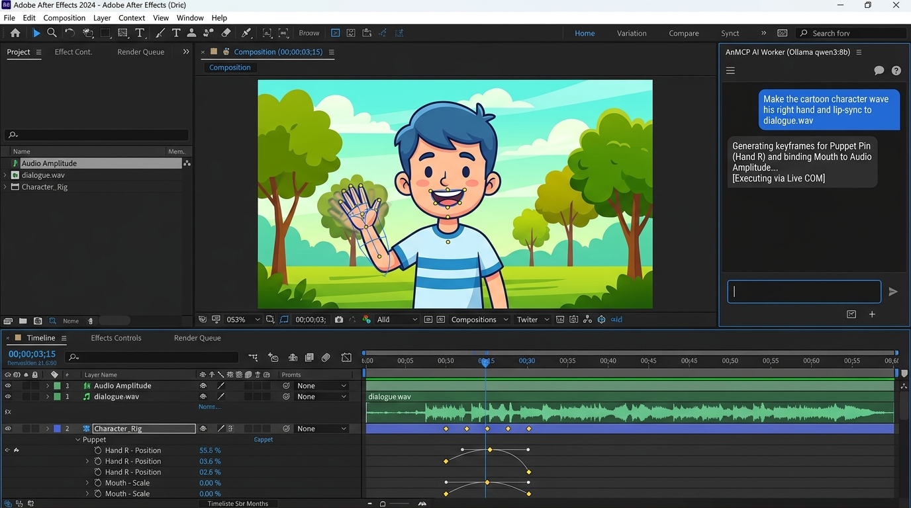

# 🎬 AnMCP: After Effects AI Worker & MCP Server

An autonomous **Model Context Protocol (MCP)** server and **AI Worker** that connects your locally running **Qwen** model (`qwen3:8b`) via **Ollama** directly to **Adobe After Effects** on Windows.


*Live Adobe After Effects Session Connected to AnMCP AI Worker (Ollama qwen3:8b): User enters a natural language prompt in the AI chat section, and After Effects immediately rigs Puppet Pins, computes Bezier keyframes, and lip-syncs the character to dialogue audio in real time.*

---

## 🌟 Key Capabilities

1. **Vision Landmark Perception (The "Eyes")**:
   - Upload any flat cartoon or character image (PNG/JPEG).
   - The integrated computer vision engine detects exact coordinates `(x, y)` for the **mouth (upper/lower lips)**, **eyes**, **wrists/hands**, and **joints**.
2. **Automated Character Rigging**:
   - Automatically drops **Adobe After Effects Puppet Tool** (`ADBE Puppet`) pins onto the detected anatomical landmark coordinates.
   - Converts flat images into fully animatable puppets without requiring manual slicing.
3. **Persistent Character Memory**:
   - Remembers character names, layer assignments, and pin indices in `data/character_registry.json`.
   - Injects the character's skeleton and pin map into Qwen's prompt context across multi-turn sessions.
4. **Automated Lip-Syncing Engine**:
   - **Audio-Driven**: Connects dialogue voice files to the character's Mouth Pin or layer scale via After Effects' native `Convert Audio to Keyframes` amplitude slider.
   - **Text-Driven**: Generates natural syllable-paced mouth movements from dialogue text.
5. **Dual-Mode Execution (Live COM + Mock Simulator)**:
   - **Mock / Simulator Mode**: Active while After Effects is downloading or offline. Validates ExtendScript syntax, simulates composition state, and exports `.jsx` files to `output_scripts/`.
   - **Live Mode**: When After Effects is open, connects instantly via Windows COM automation (`AfterEffects.Application.DoScript`) without reopening AE or losing state!

---

## 🚀 Quick Start

### 1. Requirements & Setup
- Windows 10/11
- Python 3.11+ (Managed via `uv`)
- Ollama running locally with `qwen3:8b`:
  ```bash
  ollama run qwen3:8b
  ```

### 2. Activate Virtual Environment
```powershell
cd d:\GenAI\AnMCP
.venv\Scripts\activate
```

### 3. Interactive CLI Testing
Launch the rich interactive CLI:
```powershell
python -m src.cli
```
Available interactive commands:
- `register`: Launches the **Interactive Character Onboarding Wizard** (prompts for image path, drag-and-drop support, visual description, and personality traits).
- `register <image_path> [name]`: Quick registration with image path and optional name.
- `list`: View all registered characters, their roles, visual traits, and acting styles.
- `animate <name> <prompt>`: Prompts Qwen to animate the character reflecting their personality (e.g., *"Make Hero wave his right hand enthusiastically and smile"*).
- `lipsync <name> [audio_path or dialogue text]`: Generates audio-driven or syllable-based lip sync.
- `generate <prompt>`: Creates kinetic typography, shape morphs, or camera animations.
- `status`: Check Ollama and After Effects connection status.

---

## 🔌 Connecting to MCP Clients

### In Antigravity IDE / Claude Desktop / Cursor
Add this server to your `mcp_config.json`:

```json
{
  "mcpServers": {
    "after-effects-worker": {
      "command": "d:\\GenAI\\AnMCP\\.venv\\Scripts\\python.exe",
      "args": [
        "-m",
        "src.server"
      ],
      "cwd": "d:\\GenAI\\AnMCP",
      "env": {
        "OLLAMA_HOST": "http://localhost:11434",
        "OLLAMA_MODEL": "qwen3:8b",
        "AE_EXECUTION_MODE": "auto"
      }
    }
  }
}
```

---

## 🛠️ Exposed MCP Tools

| Tool Name | Parameters | Description |
|---|---|---|
| `ae_get_system_status` | None | Returns Ollama, Qwen, and After Effects connection status |
| `ae_register_character` | `image_path`, `character_name`, `rig_type` | Uses vision to detect mouth/hands and rigs Puppet Pins in AE |
| `ae_animate_character` | `character_name`, `action_prompt` | Prompts Qwen to animate character's pins with smooth easing |
| `ae_lipsync_character` | `character_name`, `audio_path`, `dialogue_text` | Syncs mouth movement to audio amplitude or speech text |
| `ae_generate_animation` | `prompt` | Generates motion graphics, kinetic text, and scene comps |
| `ae_list_known_characters` | None | Lists all saved characters in Character Memory |
| `ae_run_raw_extendscript` | `jsx_code` | Executes raw ExtendScript directly in After Effects or Mock |

---

## 🧪 Running Automated Tests
```powershell
.venv\Scripts\pytest.exe -v
```
All unit tests and end-to-end integration tests validate vision landmark extraction, character memory persistence, lip-sync expressions, Ollama communication, and ExtendScript compilation.
